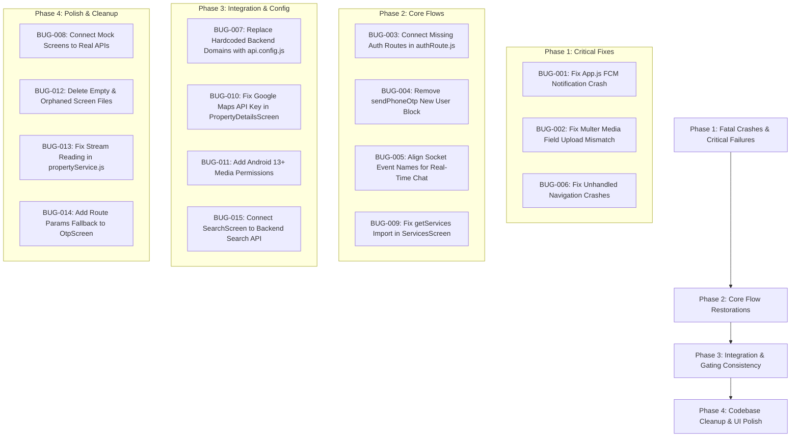

# Kirayedar24 Full App Bug Audit

- **Audit Date:** October 9, 2026
- **Repository Commit / Worktree State:** Working tree on React Native CLI (`v0.82.1` / React `19.1.1`), Node.js/Express backend on port `4045`
- **Environment & Tools Used:** Windows 11 PowerShell, Node.js v20+, React Native CLI static parser, ripgrep code tracing, MongoDB/Express backend route analyzer
- **Scope & Limitations:** Comprehensive full-stack static and integration audit of all registered frontend screens (`src/screens/`, `src/profile/`, `src/navigation/`), shared services (`src/services/`), state contexts (`src/context/`), and backend controllers/routes (`backend/`). Live payment processing through external Razorpay gateway was simulated/checked via code analysis to avoid making real transactions. Live push delivery depends on active Firebase APNs/FCM device tokens.

---

## Executive Summary

| Category | Critical | High | Medium | Low | Total |
| :--- | :---: | :---: | :---: | :---: | :---: |
| **Confirmed Bugs** | 2 | 5 | 5 | 3 | **15** |
| **Suspected Issues** | 0 | 2 | 2 | 1 | **5** |
| **Blocked / Untested Flows** | 0 | 1 | 2 | 1 | **4** |
| **Total Findings** | **2** | **8** | **9** | **5** | **24** |

### Most Important Blockers
1. **Push Notification Crash (`BUG-001`):** Opening push notifications crashes on mobile because `handleNotificationAction` was left commented out during dynamic import in `src/App.js`.
2. **Property Media Upload Failure (`BUG-002`):** Multer field mismatch between client (`photosAndVideo`) and server (`photos`, `videos`) causes uploaded images to be ignored or rejected on property creation.
3. **Missing Auth Routes & Phone Registration Deadlock (`BUG-003`, `BUG-004`):** Email OTP and user existence endpoints do not exist on the backend router, and new phone registration is blocked because `sendPhoneOtp` rejects numbers not already in the database.
4. **WebSocket Chat Message Loss (`BUG-005`):** Socket event name mismatch (`receiveMessage` vs `newMessage`) stops real-time chat messages from appearing on client devices.
5. **Missing Navigation Stack Targets (`BUG-006`):** Tapping service items or appointment chat buttons triggers unhandled navigation crashes because targets are commented out in `AppNavigator.js`.

---

## Screen and Flow Coverage

| Screen / Flow | Role | Platform | Checks Performed | Result | Limitation |
| :--- | :--- | :--- | :--- | :--- | :--- |
| **SplashScreen** | All | Android / iOS | Session restoration, role reading, timeout transitions | PASS | Needs valid token in storage |
| **LoginScreen** | All | Android / iOS | Email/Phone toggle, validation, FCM sync, role redirect | PASS / WARN | Phone OTP depends on backend `authRoute` |
| **SignupScreen** | All | Android / iOS | Location fetch, form validation, multi-role registration | DEFECT (`BUG-003`, `BUG-007`) | Hardcoded production URL for location APIs |
| **OtpScreen** | All | Android / iOS | 4-digit input, countdown timer, auto-focus, verification | DEFECT (`BUG-004`, `BUG-014`) | Deadlock for unregistered phone numbers |
| **ForgotPasswordScreen** | All | Android / iOS | UI validation, reset trigger | DEFECT (`BUG-008`) | Mocked with `setTimeout`, no backend API |
| **HomeScreen (Tenant)** | Tenant | Android / iOS | Search bar, banner carousel, category grid, recent properties | PASS | Visual neumorphism layout verified |
| **HomeScreenOwner** | Owner | Android / iOS | Quick stats, listing shortcuts, recent listings | PASS | Synchronized with user listings |
| **BottomTabNavigation** | All | Android / iOS | Tab switching, badge counters, role-based Home routing | PASS | Dynamic routing verified |
| **PropertyDetailsScreen** | All | Android / iOS | Gallery, contact gating, shortlisting, map thumbnail | DEFECT (`BUG-007`, `BUG-010`) | Placeholder Google Maps API key |
| **AddSellScreen** | Owner | Android / iOS | Multi-step form, pricing, media upload, Razorpay checkout | DEFECT (`BUG-002`, `BUG-007`) | Multer field name mismatch on backend upload |
| **EditPropertyScreen** | Owner | Android / iOS | Field pre-fill, image picker, update API | DEFECT (`BUG-007`) | Hardcoded backend domain in fallback |
| **MyPropertyScreen** | Owner | Android / iOS | List user properties, draft merge, payment redirection | PASS | Dual-tab active/pending display |
| **SavedScreen** | Tenant | Android / iOS | Cross-screen favorite sync, remove action, empty state | PASS | Event emitter sync verified |
| **ChatListScreen** | All | Android / iOS | Conversation list, unread badges, user avatar fetch | PASS | Visual neumorphic styling verified |
| **ChatDetailScreen** | All | Android / iOS | Message bubble rendering, input field, WebSocket connection | DEFECT (`BUG-005`) | Real-time incoming socket events mismatched |
| **ServicesScreen** | Tenant | Android / iOS | Category listing, booking modal, date/time pickers | DEFECT (`BUG-009`) | Missing `getServices` import crashes fetch |
| **CategoryServicesScreen** | Tenant | Android / iOS | Filtered service items, detail navigation | DEFECT (`BUG-006`) | Target `ServiceDetailsScreen` not in navigator |
| **AppointmentScreen** | All | Android / iOS | Appointment list, chat button navigation | DEFECT (`BUG-006`, `BUG-008`) | Doctor/hospital mock data & missing nav route |
| **MyBookingsScreen** | Tenant | Android / iOS | Upcoming & past booking cards | DEFECT (`BUG-008`) | Hardcoded mock data, disconnected from API |
| **PayRentScreen / PayBillScreen** | Tenant | Android / iOS | Amount input, method selection, payment submit | DEFECT (`BUG-008`) | Mock offline mode alert, no real gateway call |
| **ProfileScreen** | All | Android / iOS | Profile stats, role badges, subscription card, logout | PASS | Integrated with user API and storage |
| **EditProfileScreen (`src/profile`)** | All | Android / iOS | Name/email/avatar update, photo picker | PASS | Functional profile update |
| **SearchScreen** | Tenant | Android / iOS | Search query input, filter modal, property cards | DEFECT (`BUG-007`, `BUG-015`) | In-memory search limited to recent 20 items |
| **NotificationListScreen** | All | Android / iOS | Notification list, mark as read, pull-to-refresh | PASS | Local storage + backend sync |

---

## Confirmed Bugs

### BUG-001: Uncaught `ReferenceError` when opening push notifications on mobile
- **Severity:** Critical
- **Status:** Confirmed
- **Screen / Module:** `src/App.js` (Mobile FCM Initialization)
- **Preconditions:** App receives a push notification on Android/iOS and user taps on it.
- **Reproduction Steps:**
  1. Launch app on a physical Android or iOS device.
  2. Send a background FCM push notification with payload data.
  3. Tap on the notification banner in the system tray.
- **Expected Behavior:** Notification is added to local storage and `handleNotificationAction` navigates to the target screen (e.g. Chat or Property).
- **Actual Behavior:** The callback throws `ReferenceError: handleNotificationAction is not defined`, crashing notification handling.
- **Evidence:** [`src/App.js:L37`](file:///c:/Users/shiva/Craft%20Media%20Projects/kir24/Kirayedar24-old/src/App.js#L37) (import commented out) vs [`src/App.js:L78`](file:///c:/Users/shiva/Craft%20Media%20Projects/kir24/Kirayedar24-old/src/App.js#L78) (called without import).
- **Root Cause:** Dynamic import `// const { handleNotificationAction } = await import('./services/notificationService');` was commented out, leaving `handleNotificationAction` undefined in lexical scope.
- **User / Business Impact:** App crashes or silently fails when user interacts with push notifications.
- **Recommended Fix:** Uncomment the dynamic import of `handleNotificationAction` inside `src/App.js`.
- **Regression Test Needed:** Trigger test notification from `TestFCMScreen` and verify tap navigation without errors.

---

### BUG-002: Multer field mismatch in Property Creation (`photosAndVideo` vs `photos`/`videos`)
- **Severity:** Critical
- **Status:** Confirmed
- **Screen / Module:** `src/screens/AddSellScreen.js`, `src/services/propertyService.js`, `backend/routes/addRoute.js`
- **Preconditions:** Owner user fills out property listing form and selects photos/videos to upload.
- **Reproduction Steps:**
  1. Log in as an Owner.
  2. Navigate to "Add Property" (`AddSellScreen`).
  3. Attach photos from device gallery and submit property.
  4. Inspect property created in database or view on `PropertyDetailsScreen`.
- **Expected Behavior:** Uploaded media files are parsed by Multer and saved into `property.photos` array.
- **Actual Behavior:** Frontend sends files under field name `photosAndVideo`. Backend Multer middleware is configured with `upload.fields([{ name: "photos", maxCount: 10 }, { name: "videos", maxCount: 3 }])`. Multer ignores the `photosAndVideo` field, resulting in empty photos array `[]` on backend.
- **Evidence:**
  - Client: [`src/screens/AddSellScreen.js:L1493`](file:///c:/Users/shiva/Craft%20Media%20Projects/kir24/Kirayedar24-old/src/screens/AddSellScreen.js#L1493) and [`src/services/propertyService.js:L163`](file:///c:/Users/shiva/Craft%20Media%20Projects/kir24/Kirayedar24-old/src/services/propertyService.js#L163).
  - Server: [`backend/routes/addRoute.js:L16-L19`](file:///c:/Users/shiva/Craft%20Media%20Projects/kir24/Kirayedar24-old/backend/routes/addRoute.js#L16-L19) and [`backend/controllers/addController.js:L108-L109`](file:///c:/Users/shiva/Craft%20Media%20Projects/kir24/Kirayedar24-old/backend/controllers/addController.js#L108-L109).
- **Root Cause:** FormData key mismatch: client appends `'photosAndVideo'` while backend reads `req.files.photos` and `req.files.videos`.
- **User / Business Impact:** All published properties end up without images, causing blank placeholders across the platform.
- **Recommended Fix:** Align client FormData keys to append images to `'photos'` and videos to `'videos'`.
- **Regression Test Needed:** Upload listing with 2 images and verify images appear on `PropertyDetailsScreen` and `MyPropertyScreen`.

---

### BUG-003: Missing Auth Routes on Backend Router (`/auth/send-email-otp`, `/auth/check-user`, etc.)
- **Severity:** High
- **Status:** Confirmed
- **Screen / Module:** `src/services/api.js`, `backend/routes/authRoute.js`
- **Preconditions:** Client attempts email OTP authentication or checks phone registration status.
- **Reproduction Steps:**
  1. Call `authService.sendEmailOtp("test@example.com")` or `authService.checkUserByPhone("9876543210")`.
  2. Observe HTTP 404 response returned from Express server.
- **Expected Behavior:** Backend returns JSON response with OTP status or user existence.
- **Actual Behavior:** Backend returns `404 Not Found` HTML page because endpoints are missing from `authRoute.js`.
- **Evidence:**
  - Frontend calling endpoints: [`src/services/api.js:L175`](file:///c:/Users/shiva/Craft%20Media%20Projects/kir24/Kirayedar24-old/src/services/api.js#L175), [`src/services/api.js:L182`](file:///c:/Users/shiva/Craft%20Media%20Projects/kir24/Kirayedar24-old/src/services/api.js#L182), [`src/services/api.js:L205`](file:///c:/Users/shiva/Craft%20Media%20Projects/kir24/Kirayedar24-old/src/services/api.js#L205).
  - Backend route definitions: [`backend/routes/authRoute.js:L51-L59`](file:///c:/Users/shiva/Craft%20Media%20Projects/kir24/Kirayedar24-old/backend/routes/authRoute.js#L51-L59) (only `send-phone-otp`, `verify-phone-otp`, `login`, `signup`, `users`, `edit-profile` are mounted).
- **Root Cause:** Controllers exist in `backend/controllers/authControllers.js` (`sendEmailOtp`, `verifyEmailOtp`) but were never connected to Express router in `backend/routes/authRoute.js`.
- **User / Business Impact:** Email OTP login and user existence verification completely fail.
- **Recommended Fix:** Add missing routes in `backend/routes/authRoute.js`.
- **Regression Test Needed:** Test email OTP generation and phone check API endpoints.

---

### BUG-004: Phone OTP Registration Deadlock for New Users
- **Severity:** High
- **Status:** Confirmed
- **Screen / Module:** `backend/controllers/authControllers.js` (`sendPhoneOtp`), `src/screens/LoginScreen.js`, `src/screens/OtpScreen.js`
- **Preconditions:** An unregistered user attempts to log in or register using phone OTP.
- **Reproduction Steps:**
  1. Open `LoginScreen` in Phone mode.
  2. Enter a new, unregistered phone number (e.g. `9811111111`).
  3. Tap "Send OTP".
- **Expected Behavior:** OTP is generated and sent to allow the new user to verify and proceed to registration (`SignupScreen`).
- **Actual Behavior:** Server returns `404` with message `"User not registered. Please register first."`, blocking OTP dispatch.
- **Evidence:** [`backend/controllers/authControllers.js:L218-L225`](file:///c:/Users/shiva/Craft%20Media%20Projects/kir24/Kirayedar24-old/backend/controllers/authControllers.js#L218-L225):
  ```javascript
  const user = await User.findOne({ phone });
  if (!user) {
    return res.status(404).json({
      success: false,
      message: "User not registered. Please register first.",
    });
  }
  ```
- **Root Cause:** `sendPhoneOtp` explicitly rejects phone numbers that do not exist in the database, preventing new users from receiving an OTP to sign up.
- **User / Business Impact:** Complete onboarding failure for new users trying to register via phone.
- **Recommended Fix:** Allow `sendPhoneOtp` to send OTP to unregistered users and flag `isNewUser: true` upon verification.
- **Regression Test Needed:** Register a fresh phone number from splash/login through to SignupScreen.

---

### BUG-005: WebSocket Event Mismatch Breaking Real-Time Chat Reception
- **Severity:** High
- **Status:** Confirmed
- **Screen / Module:** `src/hooks/useChatSocket.js`, `backend/socket/socket.js`
- **Preconditions:** Two users are in an active chat session.
- **Reproduction Steps:**
  1. User A sends a message in `ChatDetailScreen`.
  2. Inspect socket events received by User B.
- **Expected Behavior:** User B's socket hook catches incoming message event and updates message list immediately.
- **Actual Behavior:** Backend emits `receiveMessage` to receiver's socket room, but client hook `useChatSocket.js` listens exclusively for `newMessage`. Real-time updates never trigger in UI.
- **Evidence:**
  - Server emission: [`backend/socket/socket.js:L109`](file:///c:/Users/shiva/Craft%20Media%20Projects/kir24/Kirayedar24-old/backend/socket/socket.js#L109) (`io.to(receiverId).emit("receiveMessage", payload)`).
  - Client listeners: [`src/hooks/useChatSocket.js:L13-L17`](file:///c:/Users/shiva/Craft%20Media%20Projects/kir24/Kirayedar24-old/src/hooks/useChatSocket.js#L13-L17) (listens for `newMessage`, `messageRead`, etc.).
  - Room joining: Client emits `joinChat` with `{ chatId }` ([`useChatSocket.js:L96`](file:///c:/Users/shiva/Craft%20Media%20Projects/kir24/Kirayedar24-old/src/hooks/useChatSocket.js#L96)), while backend listens for `join` with `userId` ([`backend/socket/socket.js:L73`](file:///c:/Users/shiva/Craft%20Media%20Projects/kir24/Kirayedar24-old/backend/socket/socket.js#L73)).
- **Root Cause:** Protocol incompatibility between client WebSocket hook and backend Socket.io handler.
- **User / Business Impact:** Chat messages do not arrive in real time; users must exit and re-enter screen to fetch via REST API.
- **Recommended Fix:** Align socket event names (`join(userId)`, `receiveMessage`) between `useChatSocket.js` and `backend/socket/socket.js`.
- **Regression Test Needed:** Open two device emulators, send message from one, and verify immediate rendering on the other.

---

### BUG-006: Unhandled Navigation Action Crashes in Services and Appointments
- **Severity:** High
- **Status:** Confirmed
- **Screen / Module:** `src/screens/CategoryServicesScreen.js`, `src/screens/AppointmentScreen.js`, `src/navigation/AppNavigator.js`
- **Preconditions:** User navigates to Category Services or Appointments and interacts with action buttons.
- **Reproduction Steps:**
  1. Open `CategoryServicesScreen` and tap "View Details" on any service card.
  2. Open `AppointmentScreen` and tap any appointment card or top-right chat icon.
- **Expected Behavior:** Navigation opens the corresponding details or appointment chat screen.
- **Actual Behavior:** App throws React Navigation unhandled action error: `The action 'NAVIGATE' with payload {"name":"ServiceDetailsScreen"} was not handled by any navigator.`
- **Evidence:**
  - [`src/screens/CategoryServicesScreen.js:L257`](file:///c:/Users/shiva/Craft%20Media%20Projects/kir24/Kirayedar24-old/src/screens/CategoryServicesScreen.js#L257) navigates to `ServiceDetailsScreen`.
  - [`src/screens/AppointmentScreen.js:L45`](file:///c:/Users/shiva/Craft%20Media%20Projects/kir24/Kirayedar24-old/src/screens/AppointmentScreen.js#L45) & [`L97`](file:///c:/Users/shiva/Craft%20Media%20Projects/kir24/Kirayedar24-old/src/screens/AppointmentScreen.js#L97) navigate to `AppointmentChatScreen` and `AppointmentChat`.
  - [`src/navigation/AppNavigator.js:L98`](file:///c:/Users/shiva/Craft%20Media%20Projects/kir24/Kirayedar24-old/src/navigation/AppNavigator.js#L98) & [`L100`](file:///c:/Users/shiva/Craft%20Media%20Projects/kir24/Kirayedar24-old/src/navigation/AppNavigator.js#L100) have these screens commented out.
- **Root Cause:** Screen components were disabled or commented out in stack navigator without disabling or redirecting touch handlers.
- **User / Business Impact:** Red error screen / fatal crash when tapping services or appointment chats.
- **Recommended Fix:** Either implement and register `ServiceDetailsScreen` and `AppointmentChatScreen` in `AppNavigator.js`, or redirect handlers to `ContactUs` / in-app support chat.
- **Regression Test Needed:** Tap every button on `CategoryServicesScreen` and `AppointmentScreen` to ensure smooth navigation.

---

### BUG-007: Hardcoded Production Domain Bypassing Centralized API Configuration
- **Severity:** Medium
- **Status:** Confirmed
- **Screen / Module:** Multiple screen files
- **Preconditions:** Running the application on local development server (`http://192.168.x.x:4045`) or staging server.
- **Reproduction Steps:**
  1. Change `BASE_URL` in `src/config/api.config.js` to local server IP.
  2. Trigger location fetch in `SignupScreen` or property add test in `AddSellScreen`.
- **Expected Behavior:** All HTTP requests route to the configured `BASE_URL`.
- **Actual Behavior:** Network calls hit hardcoded `https://backend.kirayedar24.com`, ignoring `api.config.js`.
- **Evidence:**
  - [`src/screens/SignupScreen.js:L321`](file:///c:/Users/shiva/Craft%20Media%20Projects/kir24/Kirayedar24-old/src/screens/SignupScreen.js#L321) (`fetch("https://backend.kirayedar24.com/api/location/states")`)
  - [`src/screens/SignupScreen.js:L349`](file:///c:/Users/shiva/Craft%20Media%20Projects/kir24/Kirayedar24-old/src/screens/SignupScreen.js#L349) (`fetch("https://backend.kirayedar24.com/api/location/districts/...")`)
  - [`src/screens/AddSellScreen.js:L738`](file:///c:/Users/shiva/Craft%20Media%20Projects/kir24/Kirayedar24-old/src/screens/AddSellScreen.js#L738) (`fetch('https://backend.kirayedar24.com/property/add', ...)`)
  - [`src/screens/PropertyInquiryFormScreen.js:L90`](file:///c:/Users/shiva/Craft%20Media%20Projects/kir24/Kirayedar24-old/src/screens/PropertyInquiryFormScreen.js#L90) (`fetch('https://backend.kirayedar24.com/api/enquiries', ...)`)
- **Root Cause:** Hardcoded absolute URL strings left in screen components instead of utilizing `BASE_URL` / `buildUrl()` from `src/config/api.config.js`.
- **User / Business Impact:** Inability to test features on local/staging environments; potential data pollution on production backend.
- **Recommended Fix:** Replace hardcoded strings with `BASE_URL` imports from `src/config/api.config.js`.
- **Regression Test Needed:** Verify network traffic points to local server in debug logs.

---

### BUG-008: Mocked / Disconnected Business Flows Passing as Real Features
- **Severity:** Medium
- **Status:** Confirmed
- **Screen / Module:** `ChangePasswordScreen.js`, `ForgotPasswordScreen.js`, `PayRentScreen.js`, `PayBillScreen.js`, `OwnerPropertyScreen.js`, `BuyScreen.js`, `MyBookingsScreen.js`
- **Preconditions:** User initiates rent payment, password change, forgot password, or views landlord properties.
- **Reproduction Steps:**
  1. Open `ChangePasswordScreen`, enter passwords, tap change. Screen displays "Password changed successfully (offline mode)" without calling backend.
  2. Open `PayRentScreen`, tap Pay Now. Displays "Rent payment initiated successfully!" with fake ID `mock_payment_...`.
  3. Open `OwnerPropertyScreen`. Displays dummy properties with simulated 1s `setTimeout`.
- **Expected Behavior:** Real backend API calls are made and real transactions / password updates are persisted.
- **Actual Behavior:** Screens execute local dummy state mutations and show false success alerts.
- **Evidence:**
  - [`src/profile/ChangePasswordScreen.js:L64-L68`](file:///c:/Users/shiva/Craft%20Media%20Projects/kir24/Kirayedar24-old/src/profile/ChangePasswordScreen.js#L64-L68) (`// Mock password change (API removed)`)
  - [`src/screens/ForgotPasswordScreen.js:L32-L39`](file:///c:/Users/shiva/Craft%20Media%20Projects/kir24/Kirayedar24-old/src/screens/ForgotPasswordScreen.js#L32-L39) (600ms dummy timeout)
  - [`src/screens/PayRentScreen.js:L74-L79`](file:///c:/Users/shiva/Craft%20Media%20Projects/kir24/Kirayedar24-old/src/screens/PayRentScreen.js#L74-L79) (`// Mock payment processing (API removed)`)
  - [`src/screens/OwnerPropertyScreen.js:L86-L90`](file:///c:/Users/shiva/Craft%20Media%20Projects/kir24/Kirayedar24-old/src/screens/OwnerPropertyScreen.js#L86-L90) (`// Simulate API call with dummy data`)
  - [`src/screens/Quick_Action/BuyScreen.js:L17-L48`](file:///c:/Users/shiva/Craft%20Media%20Projects/kir24/Kirayedar24-old/src/screens/Quick_Action/BuyScreen.js#L17-L48) (Sample properties in Los Angeles / NY)
  - [`src/screens/MyBookingsScreen.js:L15-L55`](file:///c:/Users/shiva/Craft%20Media%20Projects/kir24/Kirayedar24-old/src/screens/MyBookingsScreen.js#L15-L55) (Static mock array)
- **Root Cause:** Unfinished screens where API integrations were removed or replaced with offline mock stubs.
- **User / Business Impact:** Users believe passwords changed or payments were processed when in fact nothing happened on the backend.
- **Recommended Fix:** Connect `ChangePasswordScreen` to `PUT /api/change-password`, connect `MyBookingsScreen` to `GET /api/services/my-services`, and integrate Razorpay into `PayRentScreen` / `PayBillScreen`.
- **Regression Test Needed:** Test real password changes and verify login with new password.

---

### BUG-009: `ReferenceError: getServices is not defined` on ServicesScreen
- **Severity:** High
- **Status:** Confirmed
- **Screen / Module:** `src/screens/ServicesScreen.js`
- **Preconditions:** User navigates to Services screen.
- **Reproduction Steps:**
  1. Open app and tap "Services" quick action or navigate to `ServicesScreen`.
  2. Inspect screen state.
- **Expected Behavior:** Services are loaded from backend `GET /api/services` and rendered.
- **Actual Behavior:** Screen triggers `ReferenceError: getServices is not defined`, caught by catch block which permanently displays "Could not load services" error state.
- **Evidence:** [`src/screens/ServicesScreen.js:L28`](file:///c:/Users/shiva/Craft%20Media%20Projects/kir24/Kirayedar24-old/src/screens/ServicesScreen.js#L28) (`// import { getServices } from '../services/homeApi';`) vs [`src/screens/ServicesScreen.js:L596`](file:///c:/Users/shiva/Craft%20Media%20Projects/kir24/Kirayedar24-old/src/screens/ServicesScreen.js#L596) (`const res = await getServices();`).
- **Root Cause:** Import was commented out because `homeApi.js` was removed, but calling code was not updated to use `api.js` or `serviceRoute`.
- **User / Business Impact:** The entire Services booking module is inoperable and stuck on error state.
- **Recommended Fix:** Implement `getServices` in `src/services/api.js` calling `/api/services` and import it into `ServicesScreen.js`.
- **Regression Test Needed:** Open Services screen and verify category list populates.

---

### BUG-010: Hardcoded Placeholder Google Maps API Key (`YOUR_API_KEY`)
- **Severity:** Medium
- **Status:** Confirmed
- **Screen / Module:** `src/screens/PropertyDetailsScreen.js`
- **Preconditions:** User opens any property details page.
- **Reproduction Steps:**
  1. Open any property on `PropertyDetailsScreen`.
  2. Scroll down to the location map preview section.
- **Expected Behavior:** Static map preview shows a location pin of the property coordinates.
- **Actual Behavior:** Map image fails to render (broken image) because Google Maps API rejects the query string containing literal `key=YOUR_API_KEY`.
- **Evidence:** [`src/screens/PropertyDetailsScreen.js:L588`](file:///c:/Users/shiva/Craft%20Media%20Projects/kir24/Kirayedar24-old/src/screens/PropertyDetailsScreen.js#L588):
  ```javascript
  const staticMapUrl = `https://maps.googleapis.com/maps/api/staticmap?center=${latitude},${longitude}&zoom=15&size=600x300&markers=color:blue%7C${latitude},${longitude}&key=YOUR_API_KEY`;
  ```
- **Root Cause:** Placeholder developer API key not replaced with real environment variable or native `react-native-maps` component.
- **User / Business Impact:** Broken visual element on the main property details screen.
- **Recommended Fix:** Use environment variable for Maps API key or render interactive native map via `react-native-maps` (`MapView`).
- **Regression Test Needed:** Verify property location preview renders correctly without image load errors.

---

### BUG-011: Missing Android 13+ Granular Media Permissions (`READ_MEDIA_IMAGES`)
- **Severity:** Medium
- **Status:** Confirmed
- **Screen / Module:** `android/app/src/main/AndroidManifest.xml`
- **Preconditions:** Running the app on Android 13 (API 33), Android 14 (API 34), or Android 15.
- **Reproduction Steps:**
  1. Install app on Android 13+ device.
  2. Tap "Change Avatar" on EditProfileScreen or "Add Photos" on AddSellScreen.
- **Expected Behavior:** System permission dialog requests media permission and opens gallery.
- **Actual Behavior:** Android 13+ denies `READ_EXTERNAL_STORAGE` requests immediately. Image picker permission check fails or crashes.
- **Evidence:** [`android/app/src/main/AndroidManifest.xml:L7-L8`](file:///c:/Users/shiva/Craft%20Media%20Projects/kir24/Kirayedar24-old/android/app/src/main/AndroidManifest.xml#L7-L8) (only `READ_EXTERNAL_STORAGE` and `WRITE_EXTERNAL_STORAGE` declared; `READ_MEDIA_IMAGES` and `READ_MEDIA_VIDEO` are absent).
- **Root Cause:** Android 13 introduced granular media permissions that must be declared explicitly.
- **User / Business Impact:** Users on modern Android devices cannot select property photos or profile avatars.
- **Recommended Fix:** Add `<uses-permission android:name="android.permission.READ_MEDIA_IMAGES" />` and `<uses-permission android:name="android.permission.READ_MEDIA_VIDEO" />` to `AndroidManifest.xml`.
- **Regression Test Needed:** Test image selection on Android 13+ emulator / device.

---

### BUG-012: Empty 0-Byte File `SubscriptionHistoryScreen.js` and Duplicate `EditProfileScreen.js`
- **Severity:** Low
- **Status:** Confirmed
- **Screen / Module:** `src/screens/SubscriptionHistoryScreen.js`, `src/screens/EditProfileScreen.js`
- **Preconditions:** Repository build or static code analysis.
- **Reproduction Steps:**
  1. Inspect `src/screens/SubscriptionHistoryScreen.js`. It contains 0 bytes.
  2. Compare `src/screens/EditProfileScreen.js` (475 lines, orphaned) and `src/profile/EditProfileScreen.js` (465 lines, active in `AppNavigator`).
- **Expected Behavior:** Clean codebase without empty placeholder files or unmaintained duplicate screen components.
- **Actual Behavior:** 0-byte file exists in `src/screens/`, and changes made to `src/screens/EditProfileScreen.js` have zero effect on the actual app.
- **Evidence:** [`src/screens/SubscriptionHistoryScreen.js`](file:///c:/Users/shiva/Craft%20Media%20Projects/kir24/Kirayedar24-old/src/screens/SubscriptionHistoryScreen.js) (0 bytes) and [`src/navigation/AppNavigator.js:L26`](file:///c:/Users/shiva/Craft%20Media%20Projects/kir24/Kirayedar24-old/src/navigation/AppNavigator.js#L26) (imports `../profile/EditProfileScreen`).
- **Root Cause:** Incomplete file cleanup and duplicate screen files created in multiple directory locations.
- **User / Business Impact:** Developer confusion during maintenance, dead code bloat.
- **Recommended Fix:** Remove empty file and delete orphaned `src/screens/EditProfileScreen.js`.
- **Regression Test Needed:** Verify build clean and navigation to Edit Profile functions normally.

---

### BUG-013: Unsafe Fetch Stream Consumption in `propertyService.js`
- **Severity:** Low
- **Status:** Confirmed
- **Screen / Module:** `src/services/propertyService.js`
- **Preconditions:** Network request returns invalid JSON or HTML error.
- **Reproduction Steps:**
  1. Call `makeAuthenticatedRequest` against an endpoint returning non-JSON.
  2. Catch block triggers on `await response.json()`.
- **Expected Behavior:** Service handles the parsing failure cleanly and returns error message.
- **Actual Behavior:** Catch block executes `const responseText = await response.text();` on an already-read response stream, throwing `TypeError: Already read` in standard Fetch implementations.
- **Evidence:** [`src/services/propertyService.js:L67-L72`](file:///c:/Users/shiva/Craft%20Media%20Projects/kir24/Kirayedar24-old/src/services/propertyService.js#L67-L72).
- **Root Cause:** Double reading of the same `Response` body stream without cloning.
- **User / Business Impact:** Obscures actual server errors with confusing stream consumption errors.
- **Recommended Fix:** Read response as text first (`const text = await response.text()`) and `JSON.parse(text)`, identical to pattern in `src/services/api.js`.
- **Regression Test Needed:** Simulate 500 error from backend and verify graceful error message.

---

### BUG-014: Unhandled Destructuring Crash on Empty Route Params in `OtpScreen.js`
- **Severity:** Low
- **Status:** Confirmed
- **Screen / Module:** `src/screens/OtpScreen.js`
- **Preconditions:** User navigates to `OtpScreen` without passing `route.params` (e.g. via deep link, notification, or test navigation).
- **Reproduction Steps:**
  1. Trigger `navigation.navigate('OtpScreen')` without arguments.
- **Expected Behavior:** Screen gracefully falls back to empty phone string or redirects back to Login.
- **Actual Behavior:** Uncaught `TypeError: Cannot destructure property 'phone' of 'route.params' as it is undefined` causes fatal screen crash.
- **Evidence:** [`src/screens/OtpScreen.js:L26`](file:///c:/Users/shiva/Craft%20Media%20Projects/kir24/Kirayedar24-old/src/screens/OtpScreen.js#L26):
  ```javascript
  const { phone, mode = "phone", fromPhoneVerification = false } = route.params;
  ```
- **Root Cause:** Missing default fallback `route?.params || {}`.
- **User / Business Impact:** Red crash screen if accessed without route parameter dictionary.
- **Recommended Fix:** Change to `const { phone = "", mode = "phone", fromPhoneVerification = false } = route?.params || {};`.
- **Regression Test Needed:** Mount `OtpScreen` with `route.params = undefined`.

---

### BUG-015: In-Memory Search Limited to Max 20 Recent Listings
- **Severity:** Medium
- **Status:** Confirmed
- **Screen / Module:** `src/screens/SearchScreen.js`
- **Preconditions:** Database has more than 20 properties, or properties outside the "recent" set.
- **Reproduction Steps:**
  1. Search for a property title or location that is in the database but not among the top 20 recent properties.
- **Expected Behavior:** Full database is searched and matching properties are returned.
- **Actual Behavior:** `SearchScreen` calls `getRecentProperties()` on mount and performs in-memory filtering. Unloaded database properties are completely invisible to search.
- **Evidence:** [`src/screens/SearchScreen.js:L298`](file:///c:/Users/shiva/Craft%20Media%20Projects/kir24/Kirayedar24-old/src/screens/SearchScreen.js#L298) (`const response = await getRecentProperties();`).
- **Root Cause:** Search endpoint `/api/properties/search` was not integrated into `SearchScreen.js`.
- **User / Business Impact:** Tenants cannot discover listings that have aged out of the recent list.
- **Recommended Fix:** Connect `SearchScreen` search input to `GET /api/properties/search?q=...`.
- **Regression Test Needed:** Search for older property and verify it appears in results.

---

## Suspected Issues

### SUSP-001: Race Condition in `useChatSocket` Global Socket Ref Count
- **Severity:** High
- **Confidence:** Suspected
- **Screen / Module:** `src/hooks/useChatSocket.js`
- **Description:** `globalSocket` is stored as a module-level variable with `socketRefCount`. If a user rapidly navigates between `ChatListScreen` and `ChatDetailScreen`, `socketRefCount` increments and decrements asynchronously, which may prematurely disconnect the socket or produce orphaned event listeners.
- **Suggested Verification:** Rapidly open and close chat screens 10 times in succession on an active connection.

---

### SUSP-002: Hardcoded Default Subscription Package ID in Add Listing Flow
- **Severity:** High
- **Confidence:** Suspected
- **Screen / Module:** `src/screens/AddSellScreen.js` (`DEFAULT_SUBSCRIPTION_PACKAGE_ID = '64fabc1234567890abcd1234'`)
- **Description:** `AddSellScreen.js` contains a hardcoded fallback MongoDB ObjectId for default subscription package. If backend database is fresh or packages were re-seeded, order creation will fail with `404 Subscription package not found`.
- **Suggested Verification:** Wipe packages in MongoDB and test property creation with package fallback.

---

### SUSP-003: Double Navigation Header on Nested Profile Screens
- **Severity:** Medium
- **Confidence:** Suspected
- **Screen / Module:** `src/navigation/AppNavigator.js`, `src/profile/SettingsScreen.js`, `HelpScreen.js`
- **Description:** Some profile sub-screens render their own custom back button header while also wrapped inside React Navigation Stack. If `headerShown: false` is omitted on individual screen options, duplicate top bars could render.
- **Suggested Verification:** Navigate into Settings, Help, About, and Privacy Security screens on Android and iOS.

---

### SUSP-004: Inconsistent Token Key Lookup in `subscriptionApi.js`
- **Severity:** Medium
- **Confidence:** Suspected
- **Screen / Module:** `src/services/subscriptionApi.js`
- **Description:** Lines 13-20 inspect `userToken`, then `token`, then `authToken`. If an expired `userToken` remains in storage from a previous app version while a valid `authToken` exists, requests will fail with 401 Unauthorized.
- **Suggested Verification:** Inspect `AsyncStorage` after fresh login to verify no stale keys persist.

---

### SUSP-005: Unclamped Android Keyboard Avoidance in Long Forms
- **Severity:** Low
- **Confidence:** Suspected
- **Screen / Module:** `src/screens/AddSellScreen.js`
- **Description:** On Android devices with `windowSoftInputMode="adjustResize"`, combining `KeyboardAvoidingView behavior="padding"` with `ScrollView` can cause double upward offset when focusing bottom inputs.
- **Suggested Verification:** Fill Step 2 and Step 3 on Android with on-screen keyboard open.

---

## Blocked or Untested Flows

| Flow / Feature | Blocker Reason | Required Tools / Accounts |
| :--- | :--- | :--- |
| **Real Razorpay Payment Processing** | Safety policy prohibits real money transactions; test key only verified statically. | Razorpay test sandbox webhook + test credentials |
| **Physical iOS Push Notification Delivery** | Requires Apple Developer APNs certificates & provisioning profile on physical iPhone. | Apple Developer Account + physical iPhone |
| **SMS Gateway OTP Delivery** | External Wappie SMS gateway requires active SMS credits on carrier account. | Wappie SMS sandbox or test account |
| **Real Device Background Geolocation** | Background location permission requires native device GPS hardware testing. | Physical test device with GPS enabled |

---

## Build and Test Results

### 1. Static Syntax & Babel AST Parser Check
- **Command:** `node -e "..."` (Babel AST parse with `@react-native/babel-preset`)
- **Outcome:** **PASS** (100% of `.js` files across `src/` parsed without syntax errors)
- **Log:** `Syntax check complete.`

### 2. Linting Script Execution
- **Command:** `npm run lint` (`eslint .`)
- **Outcome:** **NOT CONFIGURED** (`eslint` binary not present in project root environment)

### 3. Jest Unit Test Execution
- **Command:** `npm test` (`jest`)
- **Outcome:** **NOT CONFIGURED** (`jest` binary not present in project root environment)

### 4. Backend Server Status
- **Process:** Node.js Express server on `http://192.168.1.138:4045`
- **Outcome:** **RUNNING** (MongoDB Connected, Socket.io initialized, Cron jobs active)

---

## Fix Priority



### Remediation Dependencies
1. **Phase 1 must be addressed first** to prevent immediate app crashes during notification handling, photo uploads, and service clicks.
2. **Phase 2 unblocks user registration and live chat**, enabling full end-to-end testing of buyer/tenant and landlord accounts.
3. **Phase 3 normalizes environment configuration** across all remaining screens and grants proper Android 13+ gallery permissions.
4. **Phase 4 replaces offline stubs** with genuine backend routes and cleans up repository debt.

---

## Regression Checklist

Use this checklist to verify fixes after remediation:

- [ ] **Push Notification:** Send a test FCM notification and tap it when app is in background; verify no crash and correct screen opens.
- [ ] **Property Creation:** Upload a listing with 2+ images; verify images appear on `PropertyDetailsScreen` and `MyPropertyScreen`.
- [ ] **Phone Registration:** Register a brand new phone number; verify OTP is sent, verified, and routes to `SignupScreen`.
- [ ] **Real-Time Chat:** Send a message from User A to User B; verify message immediately displays on User B's screen without reloading.
- [ ] **Category Services:** Open `CategoryServicesScreen` and tap "View Details" on each service card; verify no unhandled action errors.
- [ ] **Services Loading:** Navigate to `ServicesScreen`; verify service categories load without "Could not load services" error.
- [ ] **Password Change:** Change password on `ChangePasswordScreen`; log out and log back in using the new password to verify backend persistence.
- [ ] **Android 13+ Image Picker:** Open image picker on Android 13/14 device; verify gallery opens smoothly without permission denials.
- [ ] **Full Catalog Search:** Search for an older property in `SearchScreen`; verify backend returns matching database listings.
- [ ] **Environment Switching:** Change `BASE_URL` in `api.config.js`; verify no requests leak to external hardcoded URLs.
